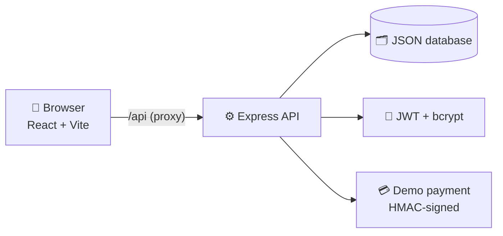

<div align="center">


# BookMyVenue

### 💍 Find it. 📅 Lock the date. 🎉 Celebrate.

**A full-stack venue booking platform for weddings, parties, corporate events and birthdays across India.**


[](https://prajwalps2603.github.io/BookMyVenue/)

<a href="https://prajwalps2603.github.io/BookMyVenue/"></a>

**https://prajwalps2603.github.io/BookMyVenue/**

*No install, no sign-up: tap **⚡ Continue with Demo Account** and start booking.*

</div>

---

## ✨ The idea

Planning an event usually means a dozen phone calls, a spreadsheet, and the fear that someone else grabbed your date.
**BookMyVenue** puts it all in one place: browse venues, see exactly which dates are free, pay an advance,
and get a ticket, with the server making sure **no two people can ever book the same day**.

## 🌐 Live demo vs. full version

👉 **Live demo: https://prajwalps2603.github.io/BookMyVenue/**

| | **Live demo** (GitHub Pages) | **Full version** (`npm run dev`) |
|---|---|---|
| Backend | A mini API that runs **in your browser** | Real Express server + JWT + bcrypt |
| Data | Saved in *your* browser only, private to you | Saved in `server/data/db.json`, shared by everyone |
| Why | GitHub Pages can only host static files | What you'd deploy for real use |

Every feature works in both. The live demo is rebuilt automatically from `main` by GitHub Actions on every push.

## 🚀 Quick start

```bash
git clone https://github.com/Prajwalps2603/BookMyVenue.git
cd BookMyVenue
npm install
npm run dev        # API on :5000 + web app on :5173, started together
```

Prefer not to install anything? Use the [live site](https://prajwalps2603.github.io/BookMyVenue/). Otherwise open **http://localhost:5173** and click **⚡ Continue with Demo Account** on the sign-in page.

| Who         | How to get in                                                            |
| ----------- | ------------------------------------------------------------------------ |
| 🙋 Customer | Demo button, or **any** email + password (demo mode creates the account) |
| 🛠️ Admin    | `admin@bmv.com` / `admin123` (always needs the real password)            |

## 🎪 What you can do

### For customers
| | |
|---|---|
| 🔎 **Smart search** | Filter by event type, city, guests, price and amenities; sort by rating or price |
| 📅 **Live availability calendar** | Booked dates are crossed out and can't be picked |
| 💳 **3-step booking** | Details → payment → confirm, with a server-verified price breakdown and a *test-mode* payment gateway |
| 🛡️ **No double bookings** | The server rechecks the date at the moment you pay |
| 🎟️ **My Bookings** | Upcoming / past / cancelled, a printable ticket, and one-click **Add to calendar** (.ics) |
| ↩️ **Fair refunds** | Cancel 15+ days ahead for a full advance refund, 50% after |
| ⭐ **Reviews & ratings** | One review per customer; venue ratings update instantly |
| ♥ **Favourites & recently viewed** | Save venues, pick up where you left off |
| 🧮 **Budget Planner** | Set budget + guests + extras (catering, decor, photography, DJ) and see which venues still fit |
| 🎊 **The little things** | Confetti on confirmation, loading skeletons, toasts, an animated sign-in with a scrolling photo wall |

### For admins (`/admin`)
- 📊 **Dashboard**: revenue, bookings, customers, 6-month revenue chart, bookings-by-type donut, most-booked venues
- 🏛️ **Venue manager**: add, edit and delete venues
- 📋 **All bookings** (with cancel) and 👥 **all users**

## 🧩 How it fits together



The browser is never trusted: the API recomputes prices, checks capacity and dates, and verifies the payment signature itself.

## 🗂️ Project map

```
.github/workflows  Auto-deploy to GitHub Pages
server/            Express API (app.js), JSON-file DB (db.js), pricing rules, tests
src/
  components/      Navbar, VenueCard, AvailabilityCalendar, PaymentModal, AuthShell, ...
  context/         Auth, Toast, Favourites
  hooks/           useVenues (one shared, cached venue list)
  pages/           Home, Venues, VenueDetails, Booking, MyBookings, Admin, Planner, ...
  services/        api.js (fetch client), mockServer.js (in-browser API for the live demo), Data.js, format.js
```

## 🧪 Scripts

| Command          | What it does                       |
| ---------------- | ---------------------------------- |
| `npm run dev`    | API + web app together             |
| `npm run client` | Web app only                       |
| `npm run server` | API only                           |
| `npm run build`  | Production build into `dist/`      |
| `npm run build:pages` | Static GitHub Pages build (in-browser mock API) |
| `npm test`       | Backend tests (Vitest + Supertest) |
| `npm run lint`   | ESLint                             |

## 📐 Business rules

- **Service fee:** 5% of the venue price. **Advance:** 50% of the total.
- **Cancellation:** full advance back if cancelled 15+ days before the event, otherwise 50% of it.
- One booking per venue per date. Guests can't exceed the venue's capacity.

## ⚠️ Before you take this to production

- 🔓 **Demo login is ON by default**: anyone can sign in as any non-admin user. Set `DEMO_LOGIN=false` (see [`.env.example`](.env.example)). The admin account always needs its real password.
- 🔑 Set a strong `JWT_SECRET` and change the admin credentials **before the first run**.
- 💳 The payment gateway is a **simulation**. Integrate Razorpay or Stripe and verify webhooks before taking real money.
- 🗄️ Data lives in `server/data/db.json` (git-ignored). Swap `server/db.js` for MongoDB or Postgres for real use.
- 🖼️ Venue photos are hot-linked from Unsplash.

## 🛣️ Ideas for next

- [ ] Real payments (Razorpay / Stripe)
- [ ] Email & SMS booking confirmations
- [ ] Venue owner accounts and a "list your venue" flow
- [ ] Image uploads instead of hot-linked photos
- [ ] Postgres / MongoDB

---

<div align="center">

🌐 **[Live demo](https://prajwalps2603.github.io/BookMyVenue/)** · 💻 **[Source](https://github.com/Prajwalps2603/BookMyVenue)**

Built with ☕ and a lot of 🎉 by **[Prajwal](https://github.com/Prajwalps2603)**

</div>
